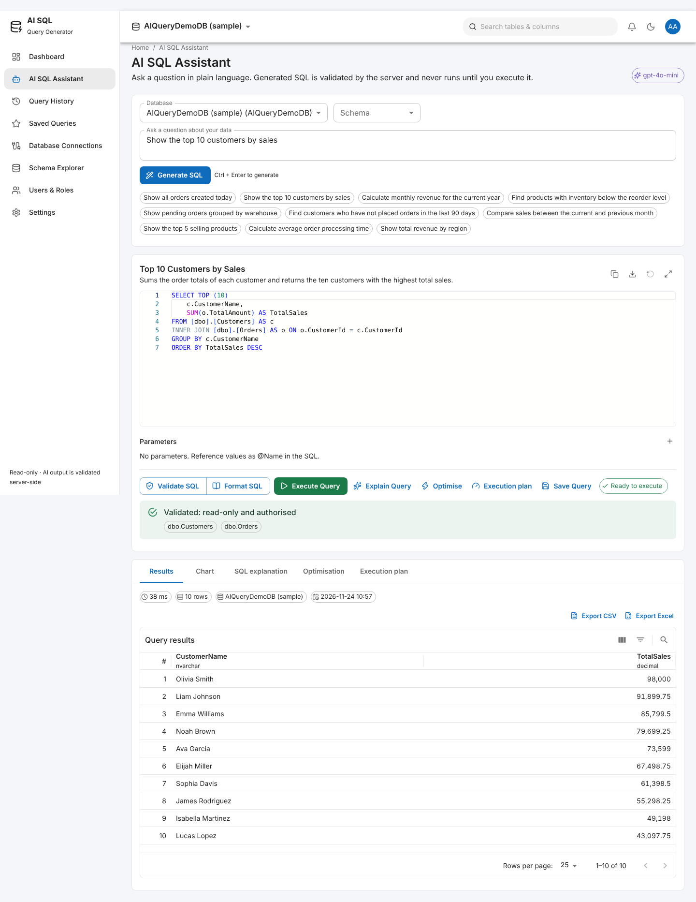

# AI SQL Query Generator

Ask questions about a Microsoft SQL Server database in plain English and get validated, read-only T-SQL, real results,
charts and exports.



## What it does

1. A user asks a question, for example *"Show the top 10 customers by sales"*.
2. The backend selects the relevant **permitted** tables and sends **schema metadata only** (never row data) to the AI provider.
3. The AI returns a structured JSON response (strict JSON schema): SQL, title, explanation, parameters and a chart suggestion.
4. The SQL is parsed with **Microsoft.SqlServer.TransactSql.ScriptDom** and checked against an allowlist of statements,
   syntax constructs and functions, and against object- and column-level permissions. If it fails, the AI gets one
   chance to repair it.
5. The user reviews and optionally edits the SQL in the Monaco editor. **Any edit invalidates the validation.**
6. Execution requires a validation token bound to the exact SQL text, parameters, user and connection. The SQL is
   **validated again**, then run through a dedicated **SELECT-only SQL Server login** inside a rolled-back transaction,
   with row, time and concurrency limits.
7. Results appear in a data grid (sorting, filtering, search, CSV/Excel export) and as ECharts charts. Every step is
   recorded in query history, execution logs and the audit log.

**The AI never executes SQL.** Everything it produces is treated as untrusted input.

## Repository layout

```
backend/
  AIQueryGenerator.sln
  src/
    AIQueryGenerator.Domain          entities, enums, domain rules
    AIQueryGenerator.Shared          response contracts, error codes, roles and permissions
    AIQueryGenerator.Application     use cases, DTOs, validators, service interfaces
    AIQueryGenerator.Infrastructure  EF Core, SqlClient/Dapper, ScriptDom validator, OpenAI client, security
    AIQueryGenerator.API             controllers, middleware, auth, rate limiting, Swagger
  tests/
    AIQueryGenerator.UnitTests         validator security tests, parsers, AI client, security components
    AIQueryGenerator.IntegrationTests  full API pipeline (in-memory SQLite + fakes), optional live SQL Server tests
  database/
    ApplicationDatabase.sql          application DB (idempotent script generated from EF migrations)
    SampleTargetDatabase.sql         AIQueryDemoDB sample business database + read-only login
frontend/ai-query-generator/        React 19 + Vite + TypeScript + MUI SPA
docs/                               Architecture, database design, API reference, deployment guide
```

## Technology

| Area | Stack |
|---|---|
| Backend | .NET 8, ASP.NET Core Web API, Clean Architecture, EF Core 8, Microsoft.Data.SqlClient, Dapper, FluentValidation, Serilog, JWT, Swagger |
| SQL safety | Microsoft.SqlServer.TransactSql.ScriptDom (TSql160Parser), allowlist AST validation, validation tokens, least-privilege login |
| AI | OpenAI / Azure OpenAI / OpenAI-compatible Chat Completions with strict `json_schema` structured outputs, behind `IAiCompletionClient` |
| Frontend | React 19, Vite, TypeScript, MUI 9, MUI X Data Grid, TanStack Query, React Router, Formik + Yup, ECharts, Monaco Editor (self-hosted), Lucide, Day.js |

## Quick start (development)

Prerequisites: .NET 8 SDK, Node.js 20 or later, and SQL Server 2019 or later (Developer Edition or a container is fine).

### 1. Create the databases

```bash
sqlcmd -S localhost -U sa -C -i backend/database/SampleTargetDatabase.sql -v ReaderPassword="Choose-A-Str0ng-Reader-Pass!"
```

```bash
sqlcmd -S localhost -U sa -C -Q "IF DB_ID('AIQueryGeneratorApp') IS NULL CREATE DATABASE AIQueryGeneratorApp"
```

The API applies EF Core migrations to the application database on start-up in Development
(`Database:Initialization = Migrate`), so `ApplicationDatabase.sql` is only needed for manual or DBA-run deployments.

### 2. Configure secrets (never commit them)

```bash
cd backend/src/AIQueryGenerator.API
dotnet user-secrets set "ConnectionStrings:ApplicationDb" "Server=localhost;Database=AIQueryGeneratorApp;User Id=sa;Password=<sa password>;TrustServerCertificate=true"
dotnet user-secrets set "Jwt:SigningKey" "<random string of at least 32 characters>"
dotnet user-secrets set "Seed:SuperAdmin:Email" "admin@example.com"
dotnet user-secrets set "Seed:SuperAdmin:Password" "<strong password>"
```

Then export the environment variables the API reads at run time:

```bash
export OPENAI_API_KEY="sk-..."
export AIQG_SECRET_DEMO_DB_PASSWORD="Choose-A-Str0ng-Reader-Pass!"
```

### 3. Run the API

```bash
cd backend && dotnet run --project src/AIQueryGenerator.API --launch-profile http
```

Swagger UI is at http://localhost:5017/swagger.

### 4. Run the frontend

```bash
cd frontend/ai-query-generator && npm install && npm run dev
```

Open http://localhost:5173 and sign in with the seeded Super Admin. The Vite dev server proxies `/api` to the API.

### 5. Activate the demo connection

The **AIQueryDemoDB (sample)** connection is seeded in Development with the `dbo` schema allowed and `Customers.Email`
restricted. Go to **Database Connections**, then **Test** (this verifies the login is read-only), switch it to
**Active**, and click **Refresh schema**. Then open **AI SQL Assistant** and try the example questions.

## Tests

```bash
cd backend && dotnet test
```

```bash
cd frontend/ai-query-generator && npm run typecheck && npm run lint && npm test
```

| Suite | Coverage |
|---|---|
| Unit tests (159) | Rejection of INSERT, UPDATE, DELETE, MERGE, DDL, EXEC, dynamic SQL, SELECT INTO, multiple statements, comment/obfuscation tricks, OPENROWSET/OPENQUERY/OPENDATASOURCE, system catalogs, cross-database and linked-server access, unauthorised tables and columns, `SELECT *` over restricted tables, plus limits, parameters, AI response parsing, the OpenAI client, prompts, secret store, validation tokens, the concurrency limiter, value conversion, the plan parser and database script syntax |
| Integration tests (50 + 4) | Authentication (refresh rotation and reuse detection, CSRF header), role and permission enforcement, the connection least-privilege gate, schema sync (incremental and full), the generate → validate → execute pipeline with a mocked AI provider, token binding, re-validation after permission changes, parameter binding, history and encryption at rest, saved queries and sharing, dashboard and audit. The 4 `SqlServerTargetTests` run against a real server when `AIQG_TEST_SQLSERVER` is set |
| Frontend (38) | Login, database selection, editor/results divider, format confirmation, SQL generation, editing invalidates validation, validation errors, execution, result grid, chart rendering and validation, query history, CSV/formula-injection safety |

> **Verification status.** The SQL Server-backed tests (`SqlServerTargetTests`) and a live OpenAI call were **not run**
> while building this project: no SQL Server instance or API key was available in the build environment. Run them with
> `AIQG_TEST_SQLSERVER="Server=...;Database=AIQueryDemoDB;User Id=aiqg_reader;Password=...;TrustServerCertificate=true" dotnet test`,
> and use **Settings → AI provider → Test active provider**. All other suites pass.

## Documentation

- [Architecture](docs/Architecture.md): layers, request flows and security model
- [Database design](docs/DatabaseDesign.md): application and sample database schemas
- [API documentation](docs/API_Documentation.md): endpoints, contracts and error codes
- [Deployment](docs/Deployment.md): IIS, configuration per environment, environment variables, backup and restore

## Roles

| Role | Can |
|---|---|
| Super Admin | Everything, including managing administrators |
| Admin | Users and roles (non-admin), connections, schema permissions, AI settings, audit |
| Developer | Generate, edit, validate and execute SQL; explain, plan, save and share queries |
| Analyst | Generate and execute AI SQL (no manual editing), charts, export, save |
| Viewer | Dashboard and shared reports |

All permissions are enforced by the API; the UI only hides what a role cannot use.
